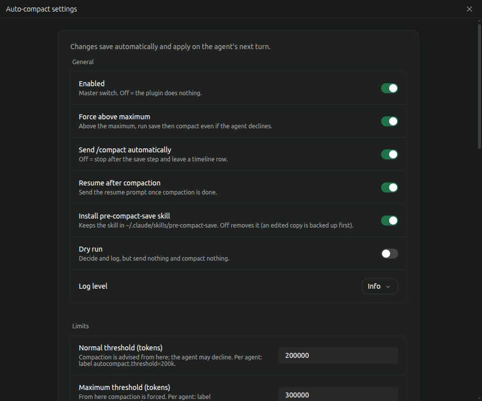

# Auto-compact assist




A Paseo plugin that keeps long-running Claude agents lean without hurting their work. When an agent's context grows past a threshold, the plugin asks the agent whether now is a good point to compact. If the agent agrees, it first saves its working state, durable learnings and skill updates to files, then the plugin sends `/compact` and, afterwards, one prompt telling the agent to resume from its notes.

Plugins are trusted code: this one sends prompts to your agents and can (opt-in) edit your Claude settings.

## How it works

Two limits per agent, `normalThreshold` and `maxThreshold` (tokens of context):

| Context | What happens |
| --- | --- |
| below `normalThreshold` | nothing; below half of it the transcript is never read |
| `normalThreshold` up to `maxThreshold` | the plugin asks for one `[compact-check]` line. Compacts only if `ready=yes`, `quality_risk <= maxRisk`, `confidence >= minConfidence`. Otherwise the decline is tolerated and it re-asks after `retryAfterTokens` more tokens (and `askCooldownMinutes`) |
| at or above `maxThreshold` | the agent can no longer opt out by risk. At its next turn end the plugin sends one mandatory save prompt (pre-compact-save skill), then sends `/compact` after the agent's reply, even if the reply lacks `ready to compact`. The `autocompact=off` label and `enabled: false` still win |

Approved flow: ask, save prompt (agent runs `pre-compact-save`, replies `ready to compact`), `/compact`, wait until the compaction really finished, then one resume prompt that repeats the task the agent was on. Forcing never interrupts a running turn: the plugin waits for the turn to end, gives exactly one save turn, then compacts. Set `forceAboveMax: false` to make `maxThreshold` advisory only.

## The `[compact-check]` grammar

One line anywhere in the reply; the last one wins:

```
[compact-check] ctx=<estimate> ready=<yes|no> quality_risk=<0-100> confidence=<0-100> reason=<text, max 80 chars>
```

`ctx` is the agent's rough guess and is informational; the plugin uses its own measurement. A malformed line is logged and treated as "no".

## Defaults and local data

- **Thresholds:** compaction is *advised* at 150,000 tokens (`normalThreshold`): the agent is asked and may decline. At 250,000 (`maxThreshold`) a save turn is *forced*: the agent must save its state and the plugin then compacts it, even if the agent did not confirm. Change both in the settings screen; turn forcing off with `forceAboveMax`.
- **Stored locally:** per-agent flow state is kept in `~/.paseo/plugin-data/auto-compact-assist/state.json` (mode 0600) so a reload or restart does not lose a pending resume. It holds the phase, timestamps and an excerpt of what the agent was doing: the task (first 500 characters) and its last output (last 600 characters), with common secret patterns (bearer tokens, API keys, `password=`/`token=` values, long hex or base64 strings) redacted by pattern. Pattern redaction is best effort and can miss secrets in unusual formats. The excerpts are used only to build the resume prompt sent back to the same agent, and nothing is sent to any other service. Delete the file to clear them.

## Setup

The plugin is **off by default**. Open **Auto-compact** in the sidebar top list (or Settings → Plugins → Auto-compact, or Command Center → "Auto-compact: open settings") and switch **Enabled** on.

Settings use Paseo's native plugin settings, stored per host in `~/.paseo/plugin-settings/auto-compact-assist/options.json` and kept across reloads, disables and updates. Every change saves automatically (switches at once, text fields 500 ms after the last keystroke); an invalid value is shown and not saved. Changes apply on the agent's next turn; no reload needed. Token values accept numbers or strings like `150k`, `1.5m`. Upgrading from 1.1.x copies the old `~/.paseo/plugin-data/auto-compact-assist/config.json` into the native settings once; that file is no longer read.

| Option | Default | Meaning |
| --- | --- | --- |
| `enabled` | `false` | Master switch |
| `normalThreshold` | `150000` | Compaction is advised from here; the agent may decline. Legacy key `thresholdTokens` still works |
| `maxThreshold` | `250000` | From here on the compaction is forced (never below `normalThreshold`) |
| `forceAboveMax` | `true` | `false`: `maxThreshold` is not enforced |
| `providerLimits` | `{}` | Per provider override, e.g. `{"codex": {"normal": "100k", "max": "200k"}}` |
| `agentInitiatedMinTokens` | `75000` | An agent's own `[compact-check]` is honoured from here |
| `maxRisk` / `minConfidence` | `30` / `70` | Decision rule between the two limits |
| `askCooldownMinutes` | `30` | Min gap between plugin asks per agent |
| `compactCooldownMinutes` | `30` | At most one compaction per agent per this long (also holds back forcing) |
| `retryAfterTokens` | `30000` | Extra tokens before re-asking after a decline |
| `autoCompact` | `true` | `false`: stop at a timeline row, you type `/compact` |
| `resume` | `true` | Send the resume prompt after compaction |
| `dryRun` | `false` | Decide and log (`dry-run-*`), send nothing, compact nothing |
| `askPrompt` / `savePrompt` / `resumePrompt` | `null` | Custom prompt templates. Placeholders: ask `{k} {tokens} {format}`, save `{k} {tokens}`, resume `{task} {last}`. A custom ask must still request the `{format}` line; a custom save prompt must still ask for `ready to compact` |
| `providers` | `["claude"]` | Providers acted on |
| `optOutLabel` | `autocompact` | Label prefix, see below |
| `onlyLabel` | `null` | `"key=value"`: act only on agents with that label (testing) |
| `logLevel` | `info` | `debug` adds per-turn timing and skip reasons |

Per-agent overrides by label (set when creating or updating the agent): `autocompact=off` never touches the agent; `autocompact.threshold=200k` and `autocompact.max=300k` replace the limits for that agent (label key prefix follows `optOutLabel`). Precedence: label, then `providerLimits`, then global.

## Opt-in helpers (Command Center)

- **Install my-context script and pre-compact-save skill:** writes `~/.local/bin/my-context` (prints `ctx=<n> threshold=<t> <ok|consider|compact>`) and the `pre-compact-save` skill into your Claude config directory. Existing files are backed up first. The skill is what teaches agents the protocol.
- **Install the Claude reminder hook:** adds a `PostToolUse` hook (`my-context --hook`) and allows `Bash(my-context)` in Claude `settings.json` (backup first). The hook is silent unless the plugin is enabled, the agent runs in Paseo, and context is over the threshold; then it reminds the agent, at most every 10 minutes, to emit the check line at its next safe point. Remove it with the matching Command Center item.

The hook is optional and off by default. The default trigger is the plugin's own turn-end check: it runs only when an agent stops, reads the token count from the agent snapshot, and does nothing below half the threshold. An agent may also end a reply with a `[compact-check]` line on its own; the plugin honours it at turn end.

## Safety rails

- Never acts on an agent with a running turn; only after completed turns.
- At most one compaction per agent per `compactCooldownMinutes`.
- Above `maxThreshold` the plugin still waits for the current turn to end, and gives one save turn before compacting.
- Per-agent opt-out label; global `enabled: false`; `paseo plugin disable`.
- Between the limits it compacts only after the agent confirms its save step with `ready to compact`; above `maxThreshold` it compacts after the one save turn regardless.
- Every decision is logged as JSON: `paseo plugin logs auto-compact-assist`.

## Requirements

Paseo 0.14.0 or later; Claude agents. License: MIT.

Settings save automatically: switches at once, text fields 500 ms after the last keystroke. A line at the top of the screen shows "Saving…", "Saved" or the error. An invalid value is shown and not saved.

Every field is pre-filled with its current value; the three prompt fields show the built-in text until you change it (saving text equal to the built-in keeps it unset, so future built-in updates still apply).

## Changelog

### 1.6.0
- Docs: README and overview explain the default thresholds and the local data the plugin stores (see "Defaults and local data").
- The optional `my-context` helper now reads the current native settings (`options.json`: `normalThreshold`, `enabled`, values like `150k`); the legacy `config.json` is only a fallback. Per-provider limits are not read by the helper, which reports the global threshold.
- New setting **Install pre-compact-save skill** (on by default). The plugin bundles the skill and installs it into `~/.claude/skills/pre-compact-save/` when missing, at startup and when the setting is on. Turning it off removes the skill; a copy you edited is moved to `SKILL.md.bak-<date>` instead of being deleted. An existing skill is never overwritten.
- The skill now also tells the agent to save durable user preference patterns (reply style, decisions, workflow, tools, naming, ownership, repeated corrections) to its persistent memory while saving state.
